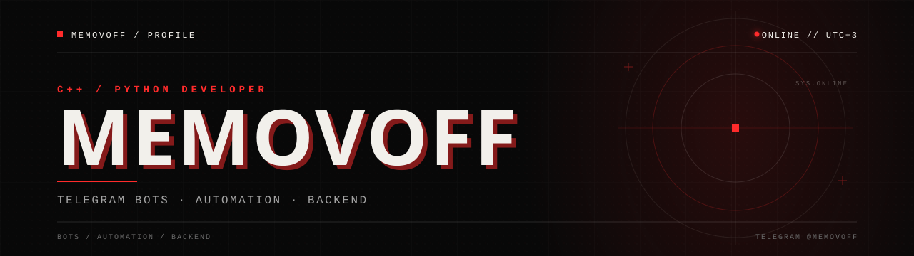
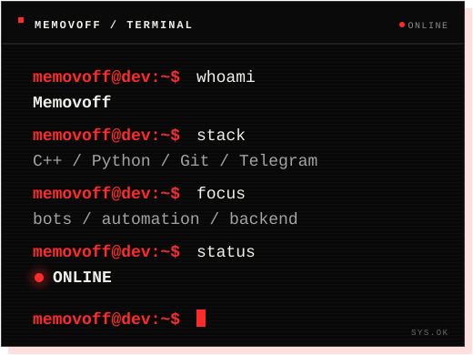
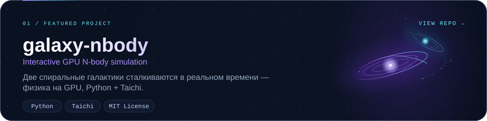
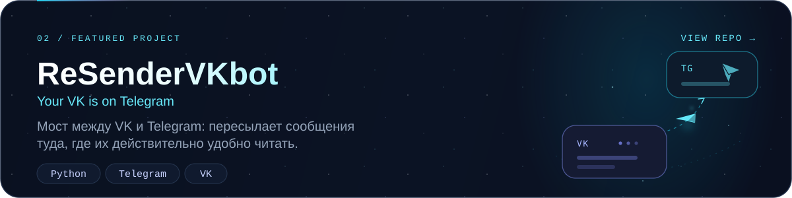

  

  Пишу на <b>C++</b> и <b>Python</b>: от GPU-симуляций галактик 
  до Telegram-ботов, которыми пользуюсь каждый день.

  
  

## Обо мне

### Привет 👋

Я **Memovoff** — разработчик, который любит разбираться, как всё устроено под капотом: от физики частиц до протоколов и ботов.

- **Сейчас** — развиваю [galaxy-nbody](https://github.com/Memovoff/galaxy-nbody), интерактивную N-body симуляцию на GPU.
- **Интересно** — системный код, физика, автоматизация и инструменты, которые делают повседневные задачи проще.
- **Формат** — работаю из дома, часовой пояс UTC+3.
- **Связь** — быстрее всего отвечу в [Telegram](https://t.me/Memovoff).

  

  
  
  
  
  

## Избранные проекты

Два проекта, которые лучше всего описывают, чем я занимаюсь:

 

## GitHub

  
  
  

  Больше экспериментов — в <a href="https://github.com/Memovoff?tab=repositories">репозиториях</a>.

  
<i>«Make it work, make it right, make it fast.»</i> 
  — Kent Beck

  
<a href="https://t.me/Memovoff"><b>Написать в Telegram →</b></a>

  Memovoff · 2026

