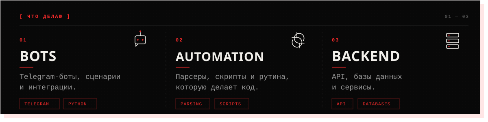
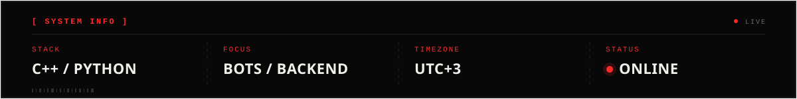

  

  <b>C++ / PYTHON</b> 
  Боты, автоматизация и бэкенд.

  
  

##  ОБО МНЕ

  

Пишу на **C++** и **Python**. Делаю Telegram-ботов, парсеры и бэкенд: от идеи и прототипа до рабочего сервиса. Работаю удалённо, **UTC+3**. Быстрее всего отвечу в [Telegram](https://t.me/Memovoff).

  
  
  
  

##  ЧТО ДЕЛАЮ

##  SYSTEM INFO

  
<b>Есть задача?</b> 
  Напиши — обсудим.

  
<a href="https://t.me/Memovoff"><b>Telegram → @Memovoff</b></a>

  Memovoff · 2026

